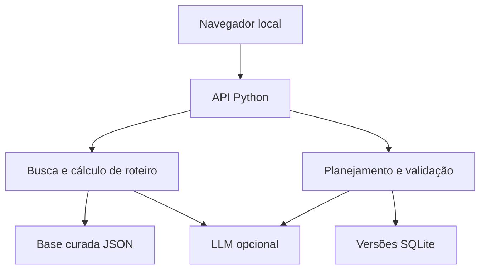

# Decisões de arquitetura

## Visão geral

## Por que biblioteca padrão

O prazo é um dia e o computador já possui Python. A versão padrão não depende de instalação de FastAPI, Node ou pacotes de ML. A API foi escrita sobre `http.server` para demonstração individual. Essa escolha reduz preparação local, mas exige substituir a camada HTTP para operação pública. Não é apresentada como stack de produção.

## Separação de responsabilidades

- `tourism.py`: regras e cálculos, sem HTTP.
- `brief.py`: template, contrato de resposta e Markdown.
- `llm.py`: comunicação externa, timeout e mensagens de erro sem chave.
- `server.py`: rotas, arquivos públicos, validação e SQLite.
- `web/`: interface sem framework, renderização com DOM seguro.

## IA e regras

Gastos e duração não são calculados pelo LLM. Ranking básico é heurístico, embeddings são opcionais. Explicação turística exige IDs conhecidos, mas ainda requer revisão do texto. BuildBrief verifica estrutura e rastreabilidade, não completude ou correção de engenharia.

## Práticas adotadas e limites

- Binding em loopback, sem exposição deliberada à rede.
- Lista permitida de arquivos; `.env` e banco não são servidos.
- Rejeição de POST de origem diferente da página local.
- Sem `eval`, execução de código gerado ou HTML vindo do modelo.
- Limite de entrada e de leitura da resposta do provedor.
- Segredos só no ambiente/backend.
- Biblioteca HTTP de desenvolvimento, sem autenticação, quotas persistentes ou observabilidade de produção.
- Mapas, fontes web e modelos têm disponibilidade externa; há fallback textual para falha do mapa, não para erro de LLM/embeddings.

## Para produção

Migrar o handler para FastAPI ou equivalente, configurar servidor de produção e proxy HTTPS, autenticação, autorização por usuário, limitação de requisições, gestão de segredos, exclusão/retenção de histórico e política de dados. Revalidar os termos dos serviços de mapas/modelos. Antes de alegar qualidade de IA, executar avaliação independente.
